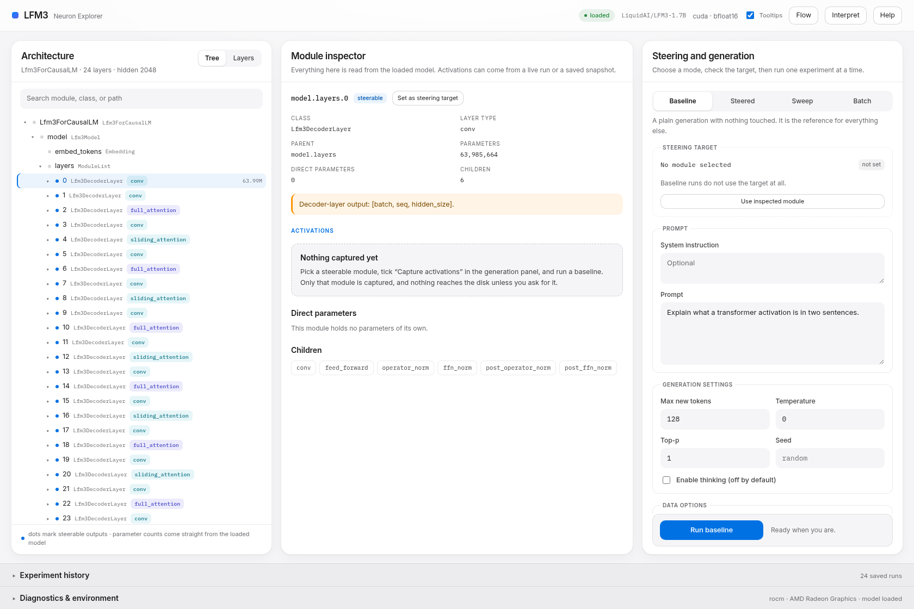
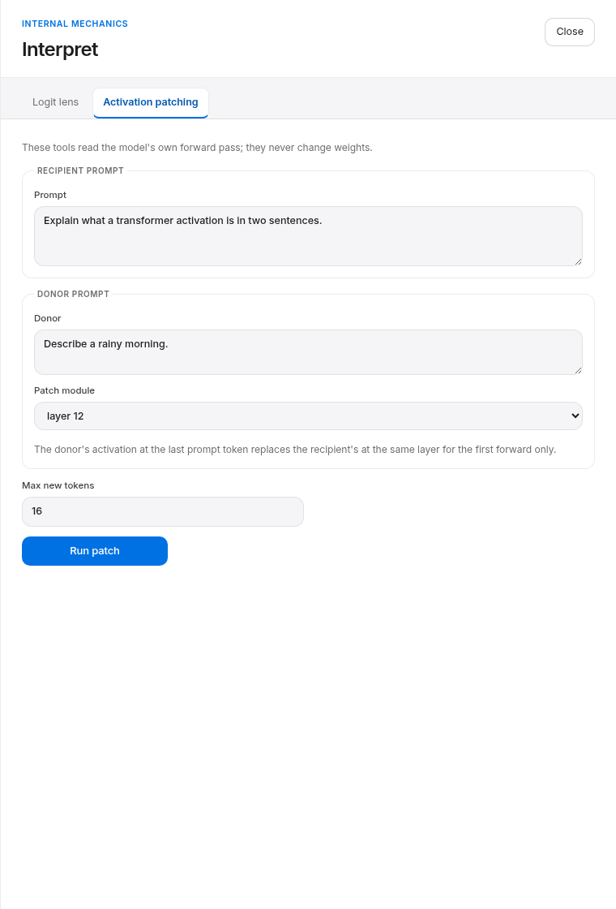
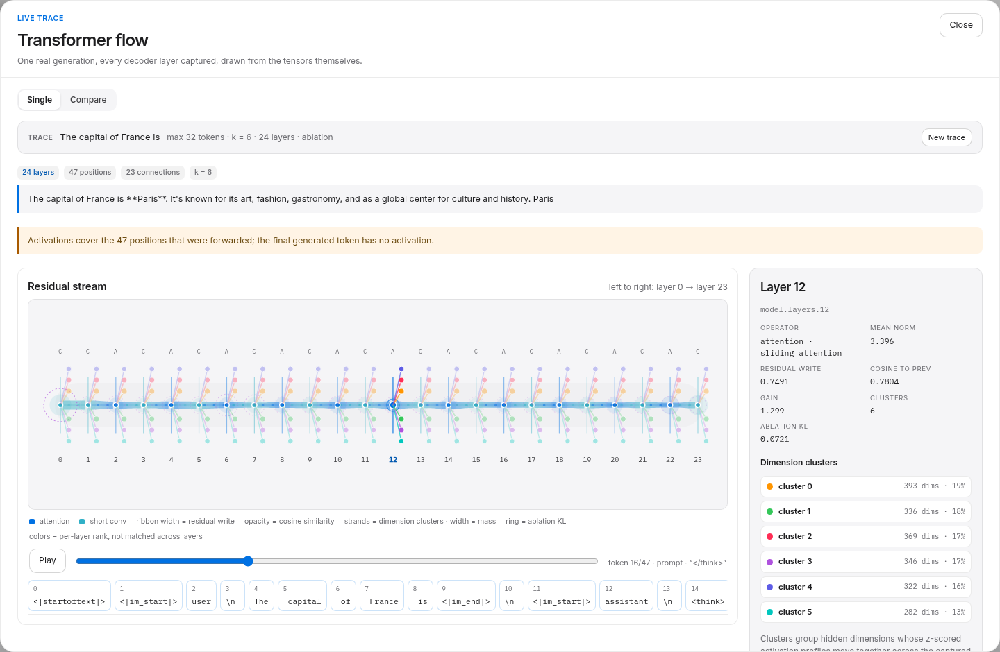
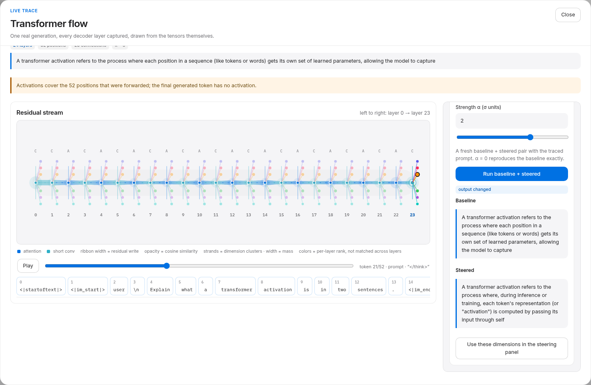
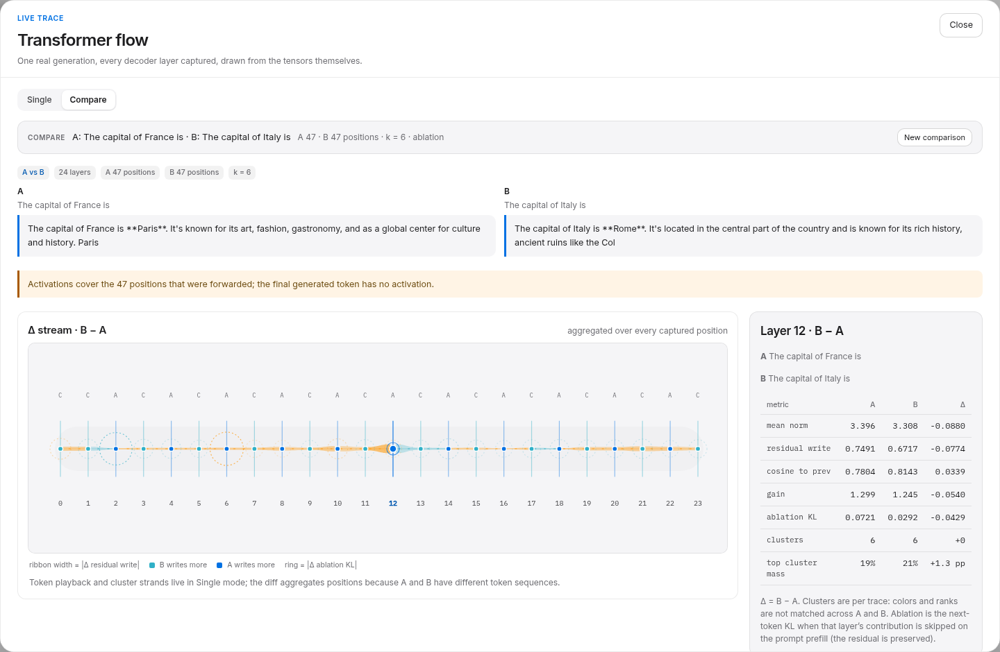
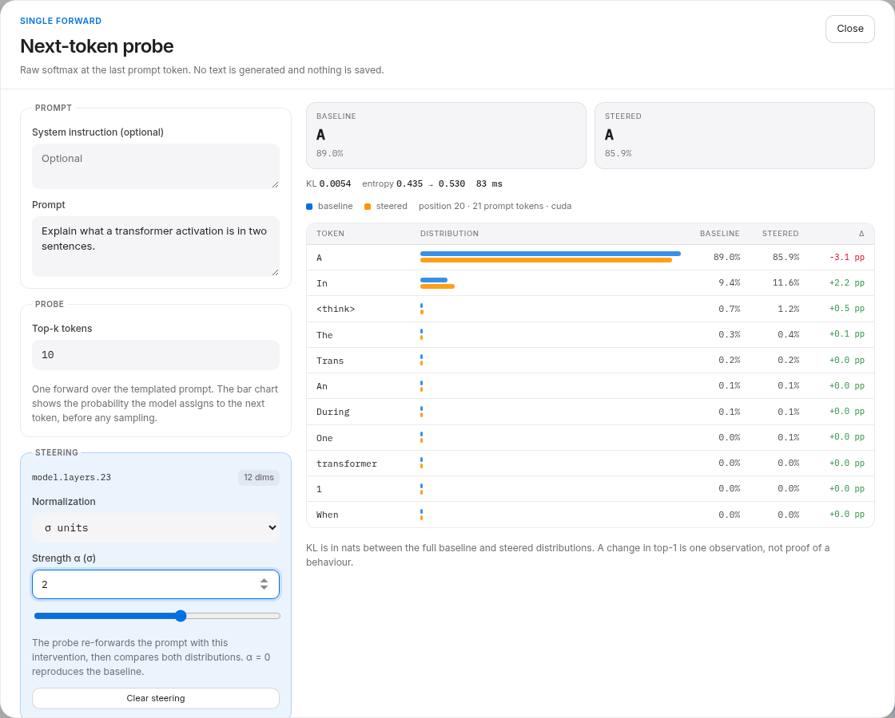
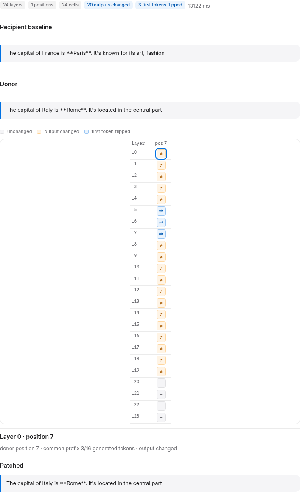
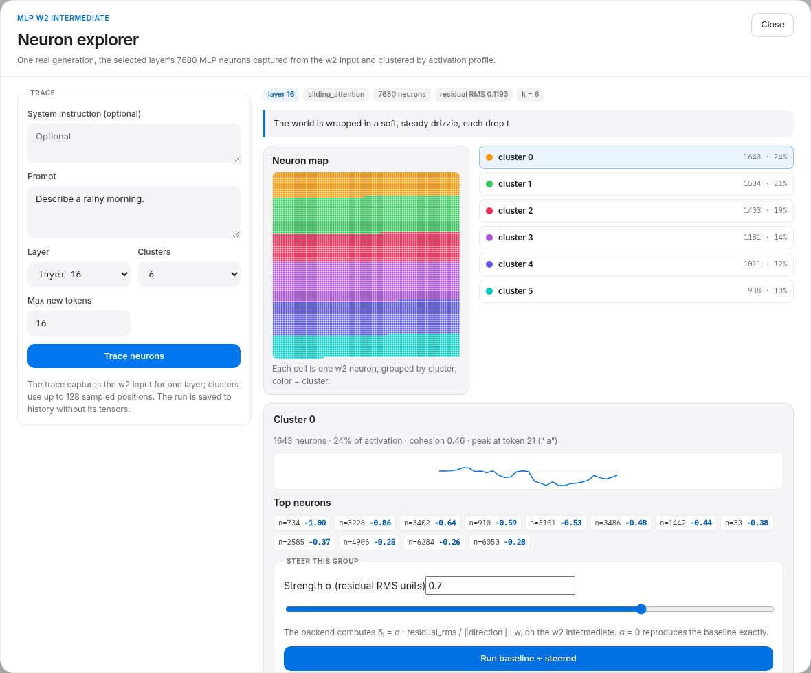
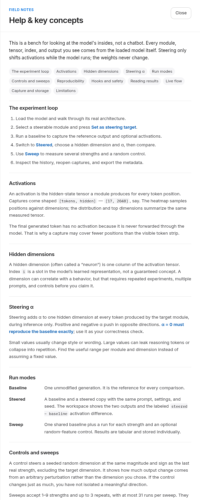

# LFM3 Neuron Explorer

Interactive activation inspection and steering GUI for [LiquidAI/LFM3-1.7B](https://huggingface.co/LiquidAI/LFM3-1.7B).

A local-first research and educational tool: explore the model's internal activations and experimentally steer its behavior during inference — without ever modifying model weights.

## What it does

- **Architecture explorer** — hierarchical view of the loaded model's real modules and layers (decoder layers, attention, short-convolution operators, MLPs), discovered from the live model, not hardcoded.
- **Activation visualization** — per-layer heatmaps, distributions, top dimensions, and per-dimension series for captured activations, with token alignment to the prompt and generated text.
- **Steering and generation** — baseline vs. steered generation using forward hooks; editable prompt, steering targets, and strengths.
- **Steering directions** — weight several hidden dimensions at once (`h[..., i] += α · w_i`), with α either in raw activation units or in σ units (each dimension's standard deviation in the current forward pass), so strengths stay comparable across layers. A direction can be built from two captured runs: restart-free contrastive extraction returns the dimensions that separate them.
- **Batch experiments** — one background job runs prompt suite × module preset × strengths (+ control, repeats), reports live progress, can be cancelled, and persists every completed run as it goes.
- **Multi-strength sweeps and controls** — run several strengths against one baseline, optionally adding a seeded random-feature control that matches the intervention magnitude.
- **Experiment history and export** — every run is saved as a JSONL metadata record; inspect, compare, reopen, and export selected or all runs as JSONL/CSV. Activation tensors stay ephemeral unless snapshot persistence is enabled.
- **Internal mechanics** — an Interpret drawer adds a logit lens (per-layer next-token predictions), a per-layer ablation map (KL of the next-token distribution when a layer’s contribution is skipped, preserving the residual stream), and activation patching between two prompts.
- **Live flow** — one real generation captured across every decoder layer, drawn as an animated residual stream: measured write/similarity between layers, per-token playback, and clusters of hidden dimensions that move together. A cluster can be steered in place (σ units, baseline vs. steered), sent to the main steering panel, or handed to the next-token probe. **Compare** traces two prompts and draws the Δ stream, with residual-preserving ablation rings. See [`docs/live-flow.md`](docs/live-flow.md).
- **Next-token probe** — one forward at the last prompt token with an optional steering spec: baseline vs. steered top-k distributions, KL, entropy, and per-token deltas. Re-probes on α changes (~80 ms warm on the reference card), generates no text, and saves nothing. Seed it from a Flow cluster or the current direction. See [`docs/next-token-probe.md`](docs/next-token-probe.md).
- **Patch sweep** — a causal-tracing grid over layers × prompt positions. The donor’s activation replaces the recipient’s at one layer/position for the first forward only; the grid marks unchanged, output-changed, and first-token-flipped cells, and each cell shows its patched text. See [`docs/patch-sweep.md`](docs/patch-sweep.md).
- **Neuron explorer (w2)** — one layer’s 7680 MLP neurons captured from the `feed_forward.w2` intermediate, clustered by activation profile, drawn as a cluster map, and steered as a group through the w2 columns in residual-RMS units. See [`docs/neurons.md`](docs/neurons.md).
- **Built-in help** — a Help drawer explains activations, hidden dimensions, α, run modes, controls, reproducibility, hooks, storage, and limitations.
- **Tooltip control** — a topbar toggle enables or disables native and heatmap tooltips; the preference persists in local storage.

Steering is inference-only via forward hooks. Hooks are installed per experiment and removed in `finally`; zero strength exactly reproduces the baseline. Experiment metadata survives backend restarts in `data/experiments.jsonl`; activation tensors are held in an in-memory store (oldest evicted) and are only written to `data/activations/` when persistence is explicitly enabled.

## Interface

Three panels, one bench: the model's real module tree, the selected module with its measured activation tensor, and a single explicit experiment (mode → target → prompt and settings → run).



*Real app screenshot after loading LFM3-1.7B and selecting `model.layers.0`; no experiment has been run in this view.*

The visual language is an Apple-inspired light system: one neutral sans (SF Pro when the OS has it, bundled Inter everywhere else), white and `#f5f5f7` surfaces, hairline separators, soft shadows, 10–20 px radii, and the system pigments (blue, teal, indigo, orange, pink, purple). Monospace is reserved for what it identifies: module paths, tensor shapes, and measured numbers. Type, color, and spacing are custom properties at the top of `frontend/src/styles.css`; the activation heatmap uses orange for positive, blue for negative, and `#f5f5f7` for zero in `colorFor()`.

The **Interpret** drawer adds logit lens, per-layer ablation and activation patching without changing weights:



*The logit lens and per-layer ablation live in the other tab.*

The **Flow** drawer traces a real generation across all 24 decoder layers. Ribbon
width is the measured residual write, opacity is consecutive-layer cosine, and
colored strands are clusters of hidden dimensions; selecting a cluster steers
its top dimensions:





*Both flow views are real runs of LFM3-1.7B on the reference RX 7600.*

The **Flow → Compare** mode traces two prompts and draws the difference. Ribbon
width is |Δ residual write| (teal: B writes more; orange: A writes more), and
rings encode |Δ ablation KL|; the inspector lists A, B, and Δ for every layer:



*France vs Italy at the next-token decision; layer 12 write 0.749 → 0.672, ablation KL 0.072 → 0.029.*

The **Probe** drawer reads the next-token distribution after a single forward.
It can be seeded from a Flow cluster, so the same dimensions that were visible in
the stream can be scanned at different α values without generating text:



*Real probe seeded from layer 23 cluster 0 at α = 2 σ; KL 0.0054, 83 ms.*

The **Interpret → Patch sweep** tab runs the same patching intervention across a
grid of layers and prompt positions:



*France vs Italy at the `" France"` token: 20/24 outputs changed and layers 5–7
flipped the first token to “Rome.”; the same sweep at the template tail changed
0/24.*

The **Neurons** drawer works one layer deeper, at the MLP `w2` intermediate:
7680 neurons per layer, clustered by activation profile and steered as a group
through their w2 columns.



*Layer 16, six clusters; the cluster map is grouped by cluster. Group steering
at α = 0.7 changed the rainy-morning output.*



## Architecture

| Layer     | Stack                                   |
|-----------|-----------------------------------------|
| Backend   | Python 3.13, FastAPI, PyTorch, Transformers |
| Frontend  | React, TypeScript, Vite                 |
| Model     | `LiquidAI/LFM3-1.7B` via `trust_remote_code=True` |

The backend is the sole authority on tensor shapes, module names, and results; the frontend never fabricates model data. When `frontend/dist` exists, FastAPI serves the built frontend at `/`.

Development is phased (see `PLAN.md`); Phases 1–7 plus the Phase 8 vector/batch/interpret work, live flow, and the next-token probe are implemented. Tested features are listed at the end of this file.

## Requirements

- Linux, Python 3.13 (`uv`-managed; system Python ≥ 3.14 is not supported by torch wheels)
- ~8 GB VRAM for GPU inference (developed on an AMD RX 7600 via ROCm 7.2 / PyTorch ROCm wheels); CPU fallback available
- The LFM3 checkpoint is **not** merged into `transformers`; the repo vendors the model code (`backend/app/vendor/`) and loads with `trust_remote_code=True`

## Getting started

### Backend

```bash
uv sync                            # create/update .venv
uv run pytest                      # tests pass without downloading model weights
uv run ruff check .                # lint
uv run uvicorn backend.app.main:app --reload
```

Host/port live in `backend/app/core/settings.py` and are env-overridable. Phase 5 settings:

| Variable | Default | Purpose |
|----------|---------|---------|
| `LFM3_DATA_DIR` | `./data` | History JSONL and optional activation snapshots |
| `LFM3_PERSIST_ACTIVATIONS` | `0` | Server default for saving activation `.npz` snapshots |
| `LFM3_MAX_STEERING_STRENGTH` | `50` | Safety limit for steering/sweep strengths |

The history file is append-only JSONL. Requests may set `persist_activations` explicitly; the UI checkbox sends an explicit boolean, while API clients that omit it use the server default.

### Frontend

```bash
cd frontend
npm install
npm run dev       # Vite dev server, proxies /api to 127.0.0.1:8000
npm run typecheck # tsc --noEmit
npm test          # Vitest + Testing Library component/integration tests
npm run build     # typecheck + build -> frontend/dist (served by FastAPI)
```

### Example experiment

1. Start the backend (`uv run uvicorn backend.app.main:app`) and frontend (`npm run dev`), open `http://localhost:5173`, and click **Load model**.
2. In the architecture explorer, open `model.layers.22.feed_forward` and select it. The inspector shows its real class and parameter shapes, and offers **Set as steering target**.
3. In the generation panel, enable **Capture activations**, keep greedy decoding (`temperature = 0`), keep the **Baseline** mode, and click **Run baseline**. The center panel now shows the measured `[tokens, 2048]` tensor with a heatmap, distribution, and top dimensions.
4. Click **Set as steering target** in the inspector, switch to **Steered**, pick a hidden dimension (for example 500), set α to a negative value (for example −12), and click **Run baseline + steered**. Both runs share the same prompt, settings, and seed; the center panel shows the labeled `steered − baseline` difference.
5. Optionally switch to **Sweep** and run several strengths (for example `-20,-10,0,10,20`) with a seeded random-feature control. Every run appears in the experiment history, where you can inspect, compare, reopen persisted activations, and export JSONL/CSV.

Zero strength must reproduce the baseline exactly. A single changed response is not evidence that a dimension controls a behavior — use repeated prompts, multiple strengths, and controls before drawing conclusions.

### Real-model integration (optional)

The default test suite uses small synthetic `Lfm3Config` models from vendored code and never downloads weights. To verify against the real checkpoint:

```bash
LFM3_RUN_INTEGRATION=1 uv run pytest backend/tests/test_integration_lfm3.py
```

Weights are cached in `~/.cache/huggingface`.

### Performance measurement

```bash
uv run python -m backend.scripts.benchmark_model --max-new-tokens 32
uv run python -m backend.scripts.benchmark_model --device cpu --max-new-tokens 8
```

Measured on the reference machine (RX 7600, ROCm 7.2, BF16, greedy, `enable_thinking=False`):

| Run | Latency | Rate |
|-----|---------|------|
| baseline, 8 tokens | 0.30 s | ~27 tok/s |
| baseline, 32 requested (20 generated before EOS) | 0.73 s | ~27 tok/s |
| baseline + activation capture | 0.73 s | ~27 tok/s |
| steered α=−12 + capture | 0.77 s | ~27 tok/s |

Model load takes ~6.5–9 s once cached; peak allocated VRAM is 3.49 GB (~3.53 GB reserved). Enabling `TORCH_ROCM_AOTRITON_ENABLE_EXPERIMENTAL=1` gave no measurable gain (~28 vs ~27 tok/s), so it is not required.

## API overview

Core endpoints (all under `/api`):

- `GET /health`, `GET /diagnostics`, `GET/POST /model/*`
- `POST /experiments/baseline`, `POST /experiments/steering`, `POST /experiments/sweep`
- `POST /experiments/direction` (weighted direction from two captured runs)
- `POST /experiments/batch` → `202` with a job; `GET /experiments/batch/{job_id}?include_runs=` for progress; `POST /experiments/batch/{job_id}/cancel`
- `GET /suites` (built-in trait and capability prompt suites with verifiable checks)
- `POST /experiments/lens` (logit lens + per-layer ablation), `POST /experiments/patch` (activation patching donor → recipient)
- `POST /experiments/flow` (capture every decoder layer and return layer metrics, per-token energy, edges, and dimension clusters)
- `POST /experiments/next-token` (one forward at the last prompt token; baseline and optional steered top-k distributions, KL, and candidates)
- `POST /experiments/patch-sweep` (causal tracing grid over layers × prompt positions; max 48 cells)
- `POST /experiments/neurons` (one layer’s w2 intermediate captured and clustered) and `POST /experiments/neuron-steering` (group steering through w2 columns in residual-RMS units)
- `GET /experiments` (filters: `condition`, `sweep_id`, `module_id`, `limit`, `offset`)
- `GET /experiments/{id}`, `GET /experiments/{id}/activations[/{module_id}]`
- `GET /experiments/export?format=jsonl|csv&ids=...` (`ids` optional; empty exports all)

## Experiments

Beyond the GUI, five scripts run reproducible pilots on the real model and write JSON + Markdown reports: `personality_pilot.py` (contrastive tone direction), `multilayer_probe.py` (multi-layer full vectors, both extraction modes), `neuron_probe.py` / `neuron_generation.py` (individual MLP neurons), `neuron_group_probe.py` (top-k neuron groups), and `format_pilot.py` (bullet-vs-prose steering). Findings: system prompts move persona strongly; single-layer, multi-layer, teacher-forced, individual-neuron, group-of-neurons, and format directions all failed to change generated text in controlled tests (and the pilot exposed a σ-mode bug that is now fixed). See [`docs/personality-pilot.md`](docs/personality-pilot.md).

## Notes and limitations

- First generation includes ~5–6 s of ROCm/SDPA warmup; steady-state decoding is ~27 tok/s on the reference RX 7600. The benchmark script warms up before timing.
- On ROCm, benign stderr noise (`(null): No such file or directory`) may appear at import.
- The ROCm torch stack is pinned in `pyproject.toml` via the `pytorch-rocm` uv index; keep those as declared direct deps.
- Batches and sweeps run **sequentially on the single loaded model**. Batches report progress and cancel cooperatively: the in-flight generation finishes, then the job stops. Only one batch runs at a time; single experiments queue behind the model's inference lock.
- Text metrics (`words`, `distinct-3`, repetition, refusal, tone markers, suite checks) are deterministic lexical/structural heuristics, not semantic judgments. They make a trait countable and keep capability visible; they do not measure quality.
- Non-persisted activations disappear when evicted (default 32 experiments / 512 MB, configurable) or when the backend restarts. History keeps the metadata and marks the tensors unavailable; enable snapshot persistence to inspect them later.
- CSV export prefixes spreadsheet formula leaders (`=`, `+`, `@`) in text cells to prevent CSV injection. Numeric columns are exported raw.
- Flow traces capture every decoder layer, so they are capped at 512 positions (about 100 MB at 24 layers × 2048 hidden). Clusters are descriptive and use at most 128 sampled positions; strand colors are per-layer ranks, not matched clusters across layers. The flow animation is a playback of a completed generation, not token streaming.
- Don't report a steering result from a single changed response — behavioral claims need experimental evidence.

## Troubleshooting

- **`torch` or `transformers` import failures / wrong Python**: use `uv run …` from the repository root. The project pins Python 3.13; the system Python (≥ 3.14) has no compatible torch wheels.
- **Model load fails with a device error**: the default is `auto` (`cuda` when ROCm/CUDA is visible, otherwise CPU). Force CPU with `LFM3_DEVICE=cpu`. If the checkpoint cannot be fetched, confirm network/HF access and that `~/.cache/huggingface` is writable.
- **GPU out of memory**: lower `max_new_tokens`, shorten the prompt, and capture fewer modules. The reference 8 GB card uses 3.49 GB for weights/activations at the tested settings.
- **`(null): No such file or directory` on stderr**: benign ROCm import noise; it does not affect inference.
- **Activation route returns 404**: the run captured no tensors, the tensor was evicted (8 experiments / 256 MB), or the backend restarted without snapshot persistence. Re-run with capture enabled and optionally enable **Persist activation snapshot**.
- **Port already in use**: set `LFM3_PORT` for the backend and update the Vite proxy if needed; Vite uses 5173 by default.
- **Frontend shows API errors in the browser but the backend works**: build the frontend (`npm run build`) when serving through FastAPI, or run `npm run dev` so Vite proxies `/api` to the backend.
- **Tests cannot find weights**: the default suites are offline by design; only the optional integration test needs the cached checkpoint.

## Tested features

Verified on the reference machine unless noted:

- Real 24-layer LFM3-1.7B architecture discovery (16 attention/conv/MLP layer layout, 2048 hidden size).
- Baseline chat generation with the model's chat template and `enable_thinking=False`.
- Activation capture for selected hidden-state modules with token alignment, heatmap data, histogram, stats, top dimensions, and feature series.
- Vector steering over up to 512 weighted dimensions in `raw` or `sigma` normalization, with exact zero-strength baseline reproduction and guaranteed hook removal.
- Contrastive direction extraction from two captured runs (mean prompt / all / last-prompt positions, top-k dimensions, per-dimension σ).
- Batch jobs across up to 64 modules and 32 strengths per prompt suite, with progress, cancellation, per-cell aggregates, and prompt-suite checks.
- Per-dimension activation statistics (mean, σ, min, max) exposed with every captured tensor.
- Baseline vs. steered pair runs, sweep runs with repeats, and seeded random-feature controls.
- JSONL experiment persistence across restarts, list/filter/pagination, detail/compare views, and JSONL/CSV export (including formula-injection protection).
- Optional activation snapshot persistence and restoration within the byte budget.
- Apple-inspired light interface: SF Pro/Inter, hairline surfaces, system pigments, and a line-based Flow graph; rendered and checked in Chromium at 1680×1120, 760×1120, and 700×1500.
- Live flow trace: all 24 decoder layers captured in one real generation; measured residual write/cosine/gain, per-token energy, deterministic dimension clusters, and in-place cluster steering. Verified on the real model (24 layers, 23 edges, 6 clusters/layer; α = 2 σ on layer 23 cluster 0 changed the text). Synthetic tests cover metrics, clustering, the 512-position budget, hook removal, and determinism.
- Next-token probe: one forward, baseline vs. steered top-k distributions, KL, entropy, and candidate deltas; seeded from a Flow cluster or the current direction. Verified on the real model (~74–83 ms warm; α = 0 gives KL 0; a cluster at α = 2 σ moved the next-token mass).
- Flow compare + ablation: A/B traces with Δ write/similarity/gain and residual-preserving per-layer ablation KL, plus ablation rings in Single mode. Verified on the real model (France vs Italy; layer 12 write 0.749 → 0.672, ablation KL 0.072 → 0.029).
- Patch sweep: layers × positions grid with unchanged/output-changed/first-token-flipped cells and per-cell patched text. Verified on the real model (France vs Italy at the country token: 20/24 changed, layers 5–7 flipped the first token; template-tail sweep: 0/24).
- Neuron explorer: w2-intermediate capture for one layer, deterministic neuron clusters, a cluster map grouped by cluster, and group steering in residual-RMS units. Verified on the real model (layer 16, 6 clusters, 1643-neuron cluster at α = 0.7 changed the output; direction norm 0.1147).
- Backend suite: 151 passed, 3 skipped offline; frontend suite: 107 tests across 12 files; production build passes.
- End-to-end HTTP smoke test: FastAPI served the built frontend, loaded the real model, returned the architecture, ran a captured baseline, and read it back from history.
- End-to-end browser smoke test: headless Chromium opened the Flow drawer, traced a real 52-position generation, selected a cluster, handed it to the Probe, and rendered the real baseline/steered distributions.
- Limits are configurable instead of hardcoded: `LFM3_MAX_STEERING_STRENGTH` (default ±1000), `LFM3_MAX_BATCH_RUNS` (2000), `LFM3_ACTIVATION_STORE_EXPERIMENTS`, `LFM3_ACTIVATION_STORE_BYTES` (512 MB).

## Repository layout

```
backend/
  app/            FastAPI app, settings, schemas, model manager, vendors
  scripts/        benchmark_model.py (real-model latency/VRAM measurement)
  tests/          pytest suite (synthetic models + optional real integration)
frontend/
  src/            React/TypeScript three-panel workspace + history/sweep panels
  src/__tests__/  Vitest component/integration tests
  dist/           built assets served by FastAPI
data/             experiment JSONL and optional activation snapshots (gitignored)
PLAN.md           full design spec and phased plan
AGENTS.md         development conventions and verified environment facts
```
