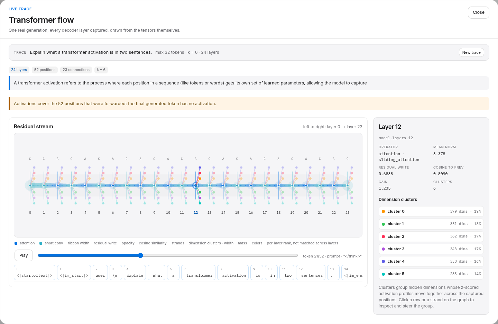
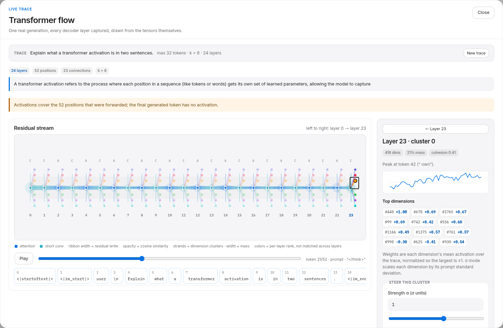
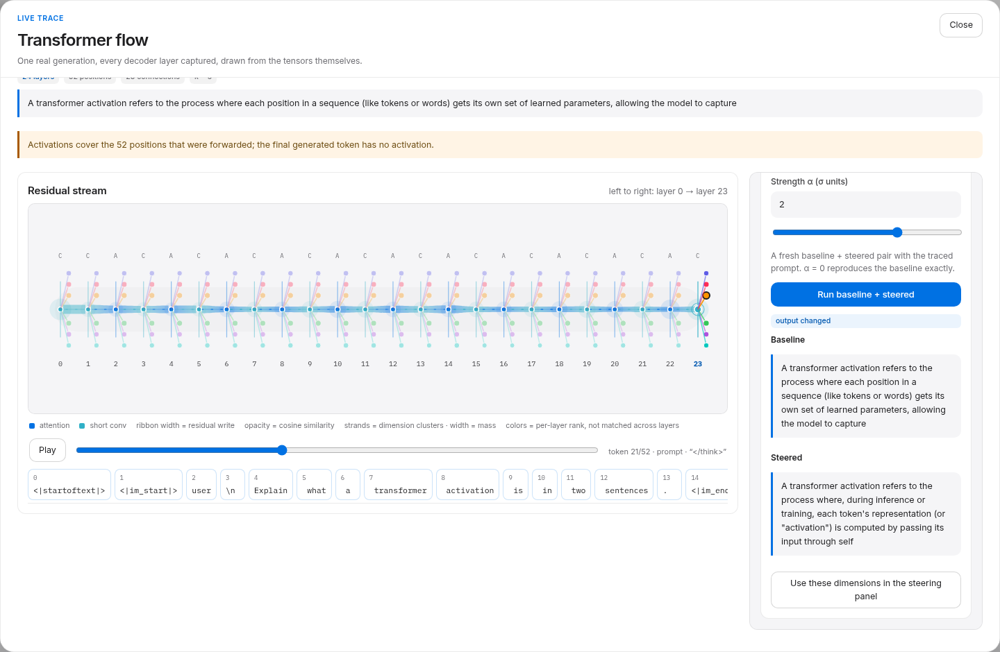

# Live flow

The **Flow** drawer (topbar → Flow) traces one real generation across every
decoder layer and draws the residual stream from the captured tensors. It is a
post-hoc playback, not a streaming generation: the model writes first, then the
drawer animates the recorded states. Every number on screen comes from that
trace.



## Run a trace

1. Load the model (the drawer explains why when it is unloaded).
2. Open **Flow**, write a prompt, choose `max_new_tokens` and the number of
   clusters per layer (3–10 in the UI; the API accepts 2–12, default 6).
3. **Trace flow** runs one greedy generation (`temperature=0`,
   `enable_thinking=False`) with all decoder layers captured. After it
   finishes, the form collapses to a compact trace card so the playback and
   token strip stay visible; **New trace** reopens it.

The trace captures every decoder layer, so it is capped at **512 positions**
(prompt + generated). That is roughly 100 MB of CPU tensors at 24 layers ×
2048 hidden × 4 bytes. The run is recorded in experiment history like any other
run; activation snapshots are written to disk only when persistence is enabled.

## What the graph encodes

| Visual | Real quantity |
|---|---|
| 24 layer markers | decoder layers `model.layers.0 … model.layers.23` |
| `A` / `C` | operator type from the model: attention or short convolution |
| ribbon width | residual write: `mean ‖h_l − h_{l−1}‖ / ‖h_{l−1}‖` over all captured positions |
| ribbon opacity | mean cosine similarity between consecutive layer states |
| node glow | the current token's activation energy (`‖h_l[t]‖`) at that layer, normalized per layer for visibility |
| moving dashes | playback of the current token; the timing is illustrative, the per-edge opacity is measured |
| colored strands | clusters of hidden dimensions; width grows with cluster mass and the endpoint dot is clickable |

The widths are measured, not decorative, and **they need not grow with depth**.
On the reference trace the first write is the largest (≈0.88) and later layers
cluster around 0.44–0.77. The drawer says this explicitly rather than implying a
monotonic story.

The layer indices under the markers are the real indices. Click a layer to read
its mean norm, residual write, cosine, gain, and cluster list. Click a colored
strand to inspect the dimensions inside that cluster. The selected layer’s fan
is shown at full opacity; the other layers keep dimmed markers so the stream
stays readable.

## What a cluster is

For each layer, the captured tensor is `[positions, 2048]`. The clustering:

1. samples up to 128 evenly spaced positions,
2. z-scores each hidden dimension across those positions (removing scale),
3. L2-normalizes each profile (comparing shape, not magnitude),
4. runs deterministic spherical k-means with `k` seeds chosen by the
   highest-mass dimensions (8 iterations).

Each cluster reports its size, mass (share of the layer's mean absolute
activation), cohesion (mean cosine to its centroid), the token where its profile
peaks, and its top dimensions. The steering weights are each dimension's mean
signed activation over the trace, normalized so the largest magnitude is ±1.

Two honesty notes:

- Clusters are **descriptive**. "These dimensions moved together on this trace"
  is not "this group controls a behaviour".
- Strand **colors are per-layer ranks**, not matched clusters across layers.
  Cluster 0 is the largest cluster in each layer, not the same neurons in every
  layer.



## Steering a cluster

Select a strand or a row, choose α in **σ units**, and press **Run baseline +
steered**. The drawer calls the normal steering endpoint with the cluster's top
12 dimensions, `normalization="sigma"`, and the traced prompt/settings. α = 0
reproduces the baseline exactly. The result shows both texts and whether the
output changed.



A null result is a real result. If the output is unchanged, the drawer says so
and suggests a larger |α| or another cluster. In the reference smoke test below,
α = 2 σ on layer 23 cluster 0 did change the text; that is one prompt and one
cluster, not evidence that the cluster causes the behaviour.

**Use these dimensions in the steering panel** sends the same components to the
main panel as a direction, where the usual modes (steered, sweep, batch) can
reuse them.

## API

`POST /api/experiments/flow`

```json
{
  "prompt": "Explain what a transformer activation is in two sentences.",
  "system": null,
  "settings": {"max_new_tokens": 32, "temperature": 0, "top_p": 1, "seed": null, "enable_thinking": false},
  "cluster_k": 6,
  "cluster_max_positions": 128,
  "persist_activations": null
}
```

The response carries `experiment_id`, tokens, `layers` (metrics, per-token
energy and delta, clusters, components), `edges`, `global_max_norm`, and
warnings. Errors: `409` when no model is loaded, `400` for a trace over the
position budget or a model with no decoder layers.

## Reference smoke test

Run on the reference RX 7600 (ROCm 7.2, bf16, greedy) on 2026-11-04:

- 24 layers, 23 connections, 52 captured positions, `k=6`; 6 non-empty clusters
  per layer (236–416 dimensions each).
- Residual writes did **not** increase monotonically:
  `0.88, 0.73, 0.65, 0.75, 0.73, 0.55, …, 0.44, 0.57`.
- Consecutive-layer cosine stayed between 0.67 and 0.90.
- Layer 23 cluster 0 at α = 2 σ changed the output:
  - baseline: `A transformer activation refers to the process where each position in a sequence …`
  - steered: `A transformer activation refers to the process where, during inference or training, each token's representation …`
- A separate α = 1 σ run on layer 12 cluster 0 left the 8-token output unchanged.

Treat these as a smoke test of the pipeline, not a controlled experiment.

## Limits

- 512 positions per trace; lower `max_new_tokens` or shorten the prompt.
- Clusters use at most 128 sampled positions; edges and energy use all positions.
- The graph is a playback of a completed generation; there is no token-by-token
  streaming.
- Animation timing is illustrative; `prefers-reduced-motion` disables the moving
  dots.
- The final generated token is never forwarded, so it has no activation and is
  not part of the trace.
