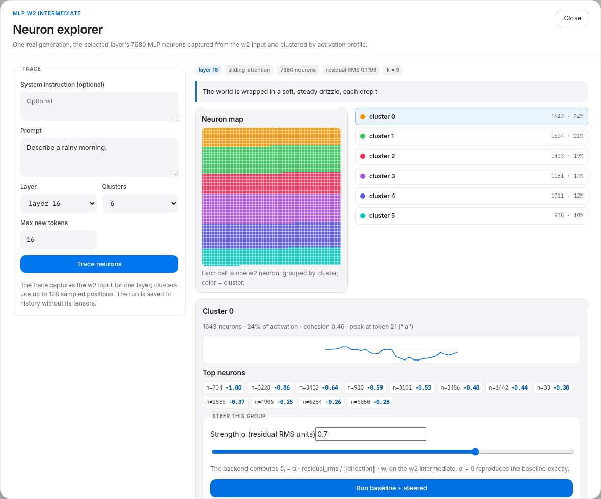
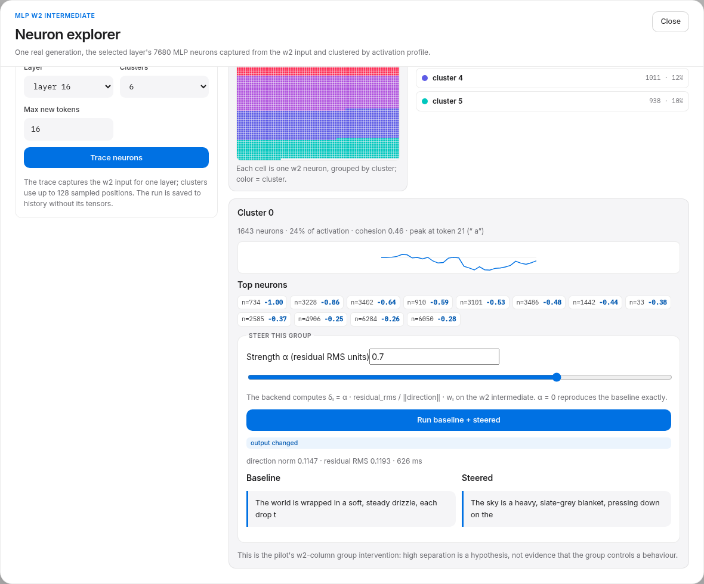

# Neuron explorer (w2)

The **Neurons** drawer works at the MLP intermediate: the input of
`model.layers.<i>.feed_forward.w2`, which is 7680 dimensions for LFM3-1.7B. A
neuron is perturbed by adding a scalar to that intermediate; its downstream
contribution is the neuron's column of `w2`. Because a sandwich RMSNorm follows
the MLP, the real per-hidden-dimension gain is `w2[:, i] * post_ffn_norm.weight`.



## Trace

1. Pick a layer (default 16), a prompt, and a cluster count.
2. **Trace neurons** runs one real generation with a forward pre-hook on that
   layer's `w2`, capturing the intermediate for every forward.
3. Neurons are clustered by their z-scored activation profiles across up to 128
   sampled positions, using deterministic spherical k-means. Each cluster
   reports size, mass, cohesion, peak token, top neurons, and a profile.
4. The map groups neurons by cluster (not by index), so each color band is one
   cluster. The cluster list shows its size and share of activation.

The trace is recorded in experiment history as a normal run, but the w2 tensor
itself is ephemeral: only the clusters and profiles are returned.

## Group steering

Select a cluster, choose **α in residual-RMS units**, and run the pair. The
backend computes

```
direction = Σ_i w_i · (w2[:, i] · post_ffn_norm.weight)
δ_i       = α · residual_rms / ‖direction‖ · w_i
```

and adds `δ_i` to the intermediate at every forward through an out-of-place
pre-hook. `α = 0` reproduces the baseline exactly; hooks are removed in
`finally`; weights never change. The steered pair is ephemeral and does not
enter experiment history.



## Reference result

Layer 16, `"Describe a rainy morning."`, greedy, 16 new tokens:

- 6 clusters: 1643 / 1504 / 1403 / 1181 / 1011 / 938 neurons; residual RMS
  0.1193.
- Cluster 0 (1643 neurons, 24% of activation) top neurons include n=734, 3228,
  3402, 910, 3101.
- α = 0.7 on that group: direction norm 0.1147; the output changed from
  *"The world is wrapped in a soft, steady drizzle…"* to *"The sky is a heavy,
  slate-grey blanket…"*.

This is one prompt and one group. The pilot found that individual/group neuron
effects are often weak and that next-token style mass is not a valid proxy for
text-level behaviour; a changed output is not proof that the group controls the
behaviour. Treat the map as a hypothesis generator.

## API

`POST /api/experiments/neurons`

```json
{
  "prompt": "Describe a rainy morning.",
  "system": null,
  "settings": {"max_new_tokens": 16, "temperature": 0, "top_p": 1, "seed": null, "enable_thinking": false},
  "layer_index": 16,
  "cluster_k": 6,
  "cluster_max_positions": 128
}
```

Returns `experiment_id`, tokens, `layer_index`, `layer_type`,
`intermediate_size`, `hidden_size`, `residual_rms`, `clusters` (with
`top_neurons`, `profile`), global `top_neurons`, `assignments` (cluster id per
neuron), and warnings.

`POST /api/experiments/neuron-steering`

```json
{
  "prompt": "Describe a rainy morning.",
  "system": null,
  "settings": {"max_new_tokens": 16, "temperature": 0, "top_p": 1, "seed": null, "enable_thinking": false},
  "layer_index": 16,
  "neurons": [{"neuron": 734, "weight": -1.0}, {"neuron": 3228, "weight": -0.86}],
  "alpha": 0.7
}
```

Returns `baseline`/`steered` generations, `direction_norm`, `residual_rms`,
per-neuron `deltas`, `duration_ms`, and warnings. Errors: `409` without a model,
`400` for an invalid layer/neuron or a zero-length direction.

## Limits

- One layer at a time; the trace captures 7680 neurons for that layer.
- Clustering is descriptive; cluster colors are per-trace ranks, not matched
  across layers.
- Group steering is one intervention at every token; it is not a causal proof.
- The neuron map groups cells by cluster, so it does not preserve neuron index
  order.
- The steered pair is ephemeral; only the trace run is recorded.
