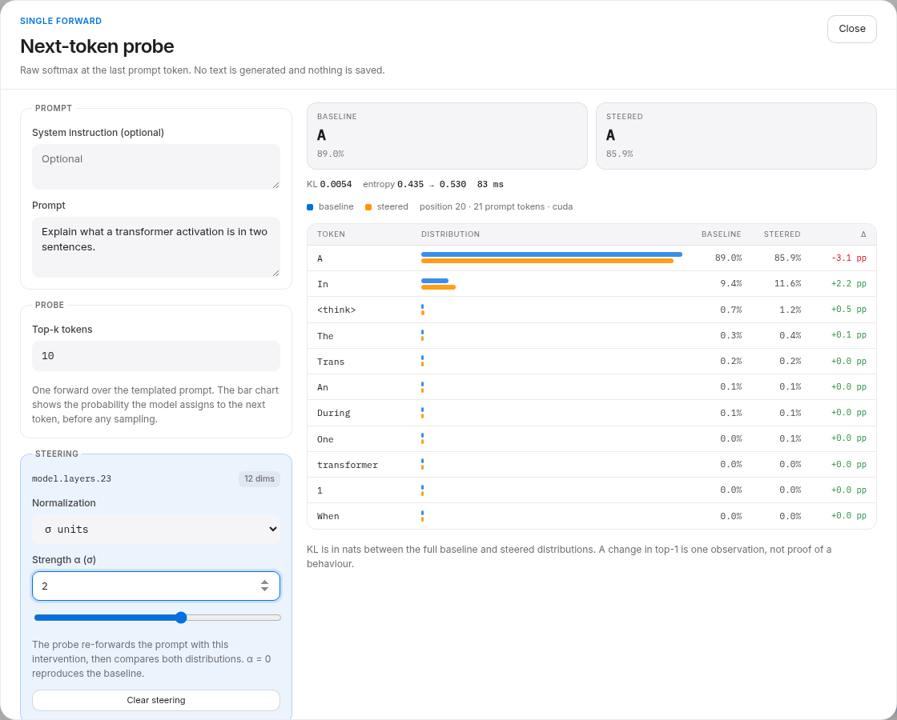

# Next-token probe

The **Probe** drawer answers a narrower question than generation: *what does the
model want to say next, right now?* It renders the chat prompt, runs a single
forward over it, and reads the raw softmax at the last prompt token. When a
steering spec is supplied, the same prompt is forwarded a second time with the
hooks installed, so the baseline and steered distributions can be compared side
by side.

Nothing is generated, nothing is sampled, and nothing is added to experiment
history. On the reference RX 7600 a probe takes ~70–90 ms once the model is warm,
so it is cheap enough to use as an interactive instrument.



## How to use it

- **Topbar → Probe.** Runs a baseline probe with the default prompt. If a
  direction is already loaded in the main panel, the probe opens with that
  direction at α = 1 σ.
- **Flow → select a cluster → Probe next token.** Opens the probe with the
  traced prompt and the cluster's top dimensions, at the α currently shown in
  the Flow inspector.
- **Change α** with the number input or the slider; the probe re-runs after a
  short debounce. **Clear steering** goes back to the baseline-only view.

The result shows:

| Element | Meaning |
|---|---|
| Baseline / Steered cards | top-1 token and its probability in each distribution |
| KL | KL divergence in nats between the full baseline and steered distributions |
| entropy | full-distribution entropy, baseline → steered |
| bars | per-token probability, blue baseline and orange steered |
| Δ | change in percentage points for each candidate token |

The candidate list is the union of the baseline and steered top-k lists, sorted
by the larger probability. Tokens outside a top-k list are still looked up in
the full softmax, so their probabilities and deltas are exact.

## API

`POST /api/experiments/next-token`

```json
{
  "prompt": "The capital of France is",
  "system": null,
  "enable_thinking": false,
  "top_k": 8,
  "steering": {
    "module_id": "model.layers.12",
    "strength": 5,
    "feature_index": 100,
    "normalization": "sigma"
  }
}
```

`steering` is optional. `top_k` is 1–50. The response carries `baseline` and
`steered` distributions (`tokens`, `entropy`), the merged `candidates`, the
`kl_divergence`, the applied `steering`, `prompt_tokens`, `position`,
`duration_ms`, and warnings. Errors: `409` without a loaded model, `400` for an
invalid steering module or strength.

The probe uses `enable_thinking=false` by default, matching the rest of the
app. It does not accept a seed because it never samples.

## Reference smoke test

Reference RX 7600, bf16, 2026-11-04:

- `"The capital of France is"`: next token `The` at 96.5%, `Paris` at 3.3%,
  entropy 0.162. The model starts a full sentence ("The capital of France is
  Paris."), so `The` is the correct first token.
- Steering `model.layers.12` dimension 100 at α = 5 σ: `The` 96.5% → 93.0%,
  `Paris` 3.3% → 6.7%, KL 0.014969.
- The same probe at α = 0: KL exactly 0.0 and identical top-k probabilities.
- Flow cluster L23 / cluster 0 at α = 2 σ: top-1 stayed `A` (89.0% → 85.9%),
  while `In` moved 9.4% → 11.6% and `</think>` moved 0.7% → 1.2%; KL 0.0054 in
  83 ms.

These are single prompts and single clusters, not causal evidence. A probe tells
you what the next-token distribution did under an intervention; it does not tell
you what the model would have written after several tokens.

## Limits

- One position: the last token of the templated prompt. It does not look at
  generated tokens.
- Raw softmax at temperature 1, not the greedy or sampled decision the
  generation panel will make.
- A steered probe is two forwards; the response time roughly doubles.
- Probes are ephemeral and never enter experiment history.
- The same honesty rule as everywhere else: a changed top-1 is one observation.
