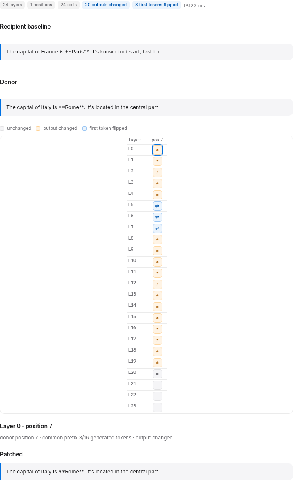

# Patch sweep

The **Interpret → Patch sweep** tab runs causal tracing over a grid of decoder
layers and prompt positions. For every cell it replaces the recipient's
activation at one layer and one prompt position with the donor's activation for
the first forward only, then generates the recipient normally. The grid shows
where the donor's information travels.



## How it works

1. The recipient is generated once to get the baseline text and token count.
2. The donor prompt is forwarded once with every decoder layer captured. Each
   layer's activation at the requested positions is kept.
3. For every layer × position cell, one recipient generation runs with an
   out-of-place hook that replaces the hidden state at that layer and position
   for the first forward only. The hook is removed in `finally`; weights never
   change.
4. The cell reports:
   - `changed`: the generated text differs from the baseline;
   - `first_token_changed`: the first generated token differs;
   - `common_prefix_tokens`: how many generated tokens still match the baseline;
   - `patched_output`: the text of that cell;
   - `donor_position`: the donor token used (the donor's last token if its
     prompt is shorter than the recipient position).

The donor's output is generated once for reference. Patch sweeps are ephemeral:
they do not enter experiment history.

## The grid

| Symbol | Meaning |
|---|---|
| `=` | unchanged |
| `≠` | output changed, first token still matches |
| `⇄` | first generated token changed |

Rows are decoder layers, columns are resolved prompt positions. Click a cell to
see its patched text, donor position, and common-prefix count.

## Reference result

Recipient `"The capital of France is"`, donor `"The capital of Italy is"`,
greedy, 8 new tokens, all 24 layers.

- **Last prompt token (position 15, the template tail):** 0/24 cells changed.
  Patching the assistant-prompt tail does not transfer the country.
- **Country token (position 7, `" France"`):** 20/24 cells changed; 3 first
  tokens flipped. Layers 5–7 generated `"Rome."` as the first token; layers 0–4
  and 8–19 kept the first three tokens and changed the answer to Italy/Rome;
  layers 20–23 did not change. The sweep took 13.1 s for 24 cells.

This is one prompt pair, not a controlled experiment. It does show that the
position matters: a causal-tracing grid at the template tail can be entirely
flat while the same donor changes the answer at the subject token.

## API

`POST /api/experiments/patch-sweep`

```json
{
  "recipient_prompt": "The capital of France is",
  "recipient_system": null,
  "donor_prompt": "The capital of Italy is",
  "donor_system": null,
  "settings": {"max_new_tokens": 8, "temperature": 0, "top_p": 1, "seed": null, "enable_thinking": false},
  "layer_indices": [0, 1, 2],
  "positions": [-1, 7]
}
```

- `layer_indices` is optional; empty means every decoder layer.
- `positions` accepts negative indices from the end; invalid positions are
  skipped with a warning.
- A sweep is capped at **48 cells** (layers × positions); each cell is one
  generation, so keep the layer range and positions small.

The response carries `baseline_output`, `donor_output`, the resolved `layers`
and `positions`, one `cells` entry per cell, `duration_ms`, and warnings.

## Limits

- Synchronous: a 24-cell sweep takes ~7–13 s on the reference RX 7600 with
  `max_new_tokens=8`; there is no background job or cancellation.
- No history entry: a patch sweep is a read-only probe, not a persisted run.
- The donor position is clamped to the donor's last prompt token when the donor
  is shorter; the cell reports the actual `donor_position`.
- One prompt pair and one intervention per cell. The grid is evidence about
  sensitivity, not a complete circuit.
